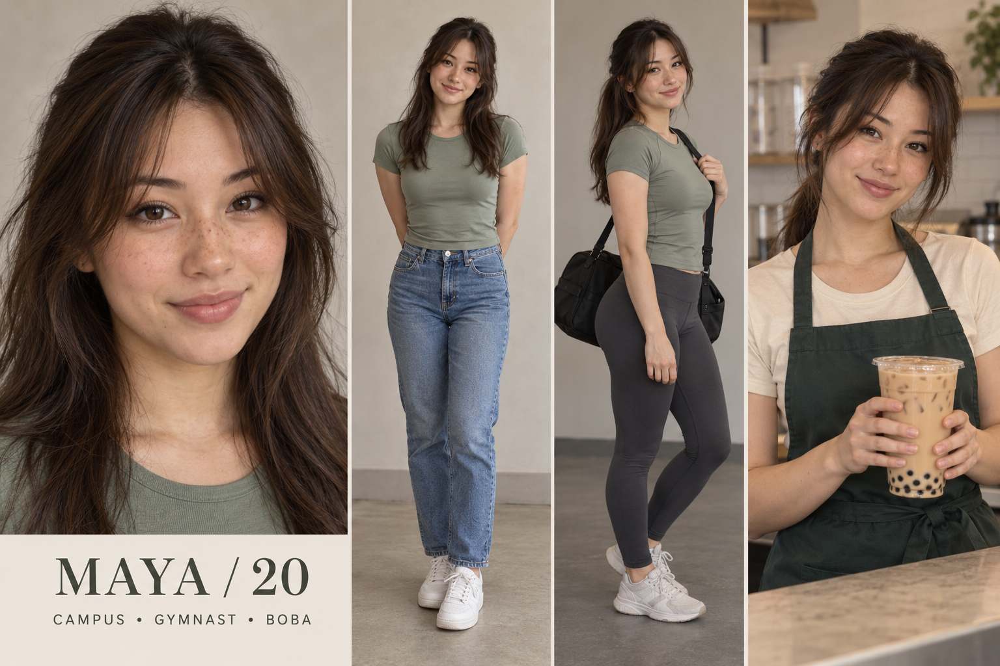

# Maya — Warm boba regular

Fictional adult woman, age 20. 5 ft 2 in (157 cm), nominal design target. College student and part-time boba barista. Recreational gymnastics; exploring Pilates. Major: Communications.

## Appearance and continuity
Chinese and Irish heritage, warm light skin, softly oval face, brown almond-shaped eyes, dark chestnut shoulder-blade length hair with curtain fringe, faint freckles across nose, slightly asymmetric friendly smile. This is an individual fictional design, not a heritage-based beauty formula.

Campus: sage fitted crew-neck tee, straight blue jeans, white sneakers.
Gym/Pilates: sage athletic crew-neck top and charcoal full-length leggings.
Tea counter: cream tee and dark green apron, hair in low ponytail.
Beauty: Sheer peach blush, brown mascara and rose lip tint; natural freckles remain visible.

Lock the selected face, complexion, haircut and body proportions to this reference; small marks need a dedicated reference close-up before production. Heritage and exact height cannot be verified visually from the sheet.

## Personality and performance
Warm, observant and lightly teasing; remembers everyone's order but forgets where she put her keys.

Voice: Conversational mid-register voice, relaxed pace, short amused pauses. No affected baby voice.

Appeal hypothesis: Friendly eye contact and humor create approachability; beauty routines supply a reason to save and follow.

## Brand positioning
Lip tints, everyday cosmetics, matcha kits, reusable cups, small tote bags.

Recurring series:
- Your order, explained kindly
- Five-minute campus face
- From tea shift to mat class

Draft fictional hooks:
- “Your matcha deserves better than this clump.”
- “This lip combo matches my drink. Accidentally.”
- “I packed for Pilates like it was a weekend trip.”

## Direction to watch
Can become generic if every clip is just smiling with a drink. Keep her observant barista humor.

Use disclosed fictional storytelling and accurate product demonstrations. No invented testimonial, real school affiliation or actual partnership is implied. All audience advantages remain untested.

