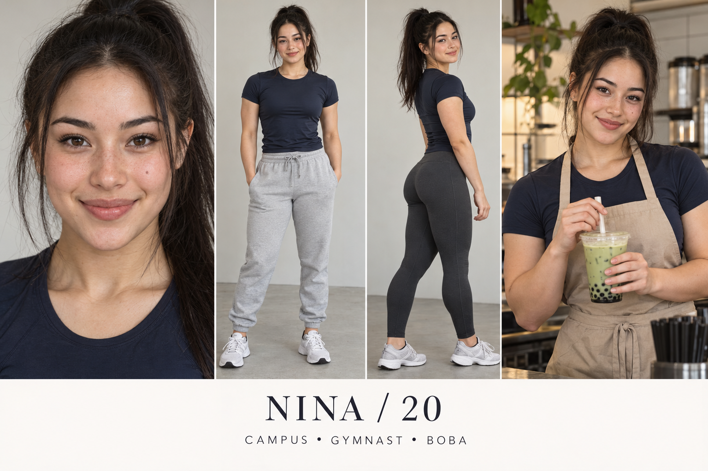

# Nina — Competitive campus athlete

Fictional adult woman, age 20. 5 ft 2 in (157 cm), nominal design target. College student and part-time boba barista. Recreational gymnastics; exploring Pilates. Major: Kinesiology student; not a licensed trainer.

## Appearance and continuity
Korean and German heritage, light neutral skin, defined oval jaw, straight dark eyebrows, deep brown eyes, black hair in high ponytail, small mole on left cheek, broad confident smile, visibly strong shoulders and compact muscular legs. This is an individual fictional design, not a heritage-based beauty formula.

Campus: navy fitted athletic tee, gray joggers, trainers.
Gym/Pilates: navy athletic tee and charcoal full-length leggings.
Tea counter: navy tee and sand apron, hair tied up.
Beauty: Brushed brows, minimal base, coral lip balm; practical ponytail.

Lock the selected face, complexion, haircut and body proportions to this reference; small marks need a dedicated reference close-up before production. Heritage and exact height cannot be verified visually from the sheet.

## Personality and performance
Competitive with herself, quick to laugh when humbled, organized about training but chaotic about laundry.

Voice: Bright, direct delivery with playful confidence and a quick laugh.

Appeal hypothesis: Capability and playful confidence give athletic viewers something beyond a portrait; practical beauty adds category relevance.

## Brand positioning
Pilates grip socks, gym bags, hair ties, activewear and straightforward beauty basics.

Recurring series:
- Gymnast tries Pilates
- What's in the training bag
- Get ready between class and shift

Draft fictional hooks:
- “Gymnast confidence. First Pilates class humility.”
- “My gym bag has a snack pocket problem.”
- “The ponytail is doing most of the styling today.”

## Direction to watch
Do not position her as a qualified instructor or fabricate athletic performance and product sweat tests.

Use disclosed fictional storytelling and accurate product demonstrations. No invented testimonial, real school affiliation or actual partnership is implied. All audience advantages remain untested.

