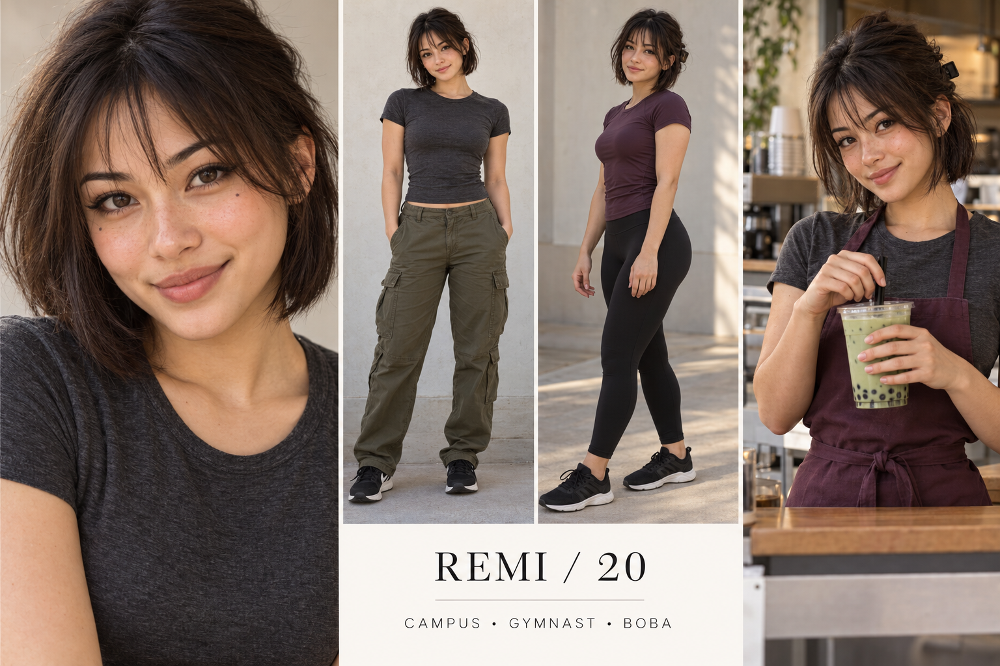

# Remi — Witty alternative creative

Fictional adult woman, age 20. 5 ft 2 in (157 cm), nominal design target. College student and part-time boba barista. Recreational gymnastics; exploring Pilates. Major: Graphic design.

## Appearance and continuity
Japanese and French heritage, light olive skin, angular oval face, dark brown eyes, chin-length dark espresso bob with wispy fringe, subtle winged eyeliner, tiny beauty mark below right eye, playful half smile. This is an individual fictional design, not a heritage-based beauty formula.

Campus: washed charcoal fitted tee, olive cargo pants, black sneakers.
Gym/Pilates: plum athletic tee and black full-length leggings.
Tea counter: charcoal tee and plum apron, short hair pinned away from face.
Beauty: Soft plum liner, muted berry tint, dark short bob with visible texture.

Lock the selected face, complexion, haircut and body proportions to this reference; small marks need a dedicated reference close-up before production. Heritage and exact height cannot be verified visually from the sheet.

## Personality and performance
Deadpan, inventive and sociable once comfortable; makes elaborate playlists for short walks.

Voice: Dry, slightly slower delivery; understated punchlines rather than constant enthusiasm.

Appeal hypothesis: A distinct haircut and dry wit support recognition; color-led tutorials connect directly to cosmetics.

## Brand positioning
Eyeliners, tinted balms, hair styling, phone accessories and independent lifestyle products.

Recurring series:
- Color theory at the boba counter
- One liner, three moods
- Design student packs a mat bag

Draft fictional hooks:
- “My eyeliner has a stronger deadline policy than I do.”
- “I color-matched my lip tint to taro.”
- “The tote is organized. The semester is not.”

## Direction to watch
Avoid making sarcasm cruel or adopting a fake alternative subculture identity without consistent taste.

Use disclosed fictional storytelling and accurate product demonstrations. No invented testimonial, real school affiliation or actual partnership is implied. All audience advantages remain untested.

