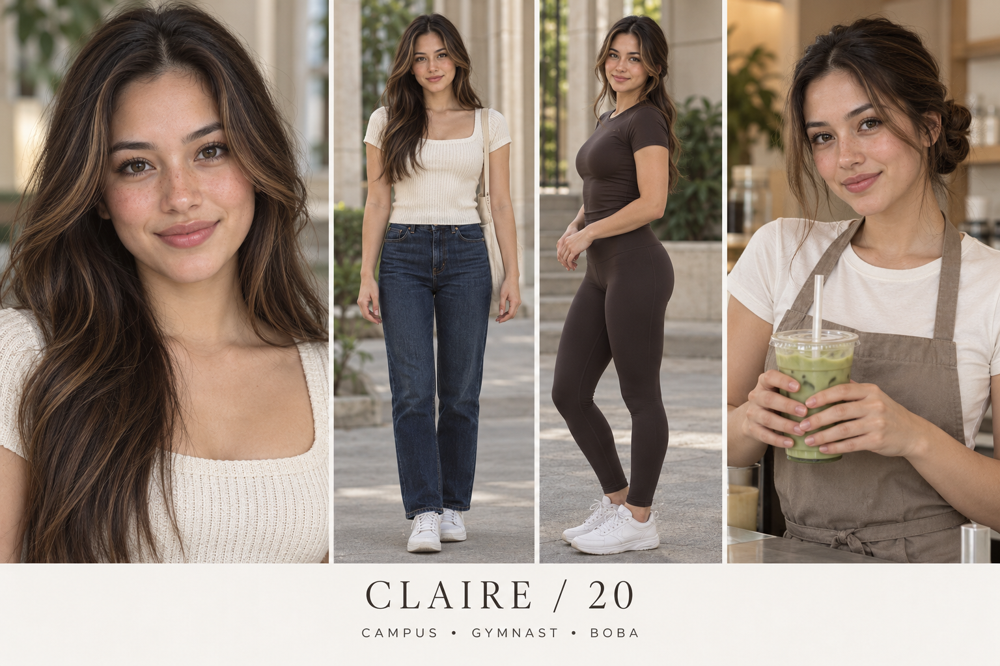

# Claire — Polished campus minimalist

Fictional adult woman, age 20. 5 ft 2 in (157 cm), nominal design target. College student and part-time boba barista. Recreational gymnastics; exploring Pilates. Major: Business administration.

## Appearance and continuity
Vietnamese and Scottish heritage, light warm skin, longer oval face, dark hazel eyes, long espresso hair with soft caramel face-framing highlights, graceful straight nose, defined natural cupid bow, soft composed smile. This is an individual fictional design, not a heritage-based beauty formula.

Campus: cream knit short-sleeve top, dark straight jeans, simple white sneakers.
Gym/Pilates: espresso athletic tee and matching full-length leggings.
Tea counter: cream tee and taupe apron, hair in neat low bun.
Beauty: Soft brown liner, rose-nude lips, subtle blush and naturally textured skin.

Lock the selected face, complexion, haircut and body proportions to this reference; small marks need a dedicated reference close-up before production. Heritage and exact height cannot be verified visually from the sheet.

## Personality and performance
Composed but self-aware; likes neat routines and admits when the routine takes too long.

Voice: Clear, calm delivery with occasional understated jokes; friendly rather than aloof.

Appeal hypothesis: Composed styling and direct gaze provide visual appeal; comparison content makes the account useful to beauty shoppers.

## Brand positioning
Everyday premium-positioned makeup, brushes, cosmetic bags, matcha tools and Pilates accessories.

Recurring series:
- One bag, class to Pilates
- Three shades in daylight
- Matcha before the calendar

Draft fictional hooks:
- “Three lip shades. Same daylight. Pick your favorite.”
- “The tiny bag has to earn its place.”
- “My morning routine needed fewer steps.”

## Direction to watch
Over-polished perfection can feel like an ad. Retain casual environments, texture and modest everyday problems.

Use disclosed fictional storytelling and accurate product demonstrations. No invented testimonial, real school affiliation or actual partnership is implied. All audience advantages remain untested.

