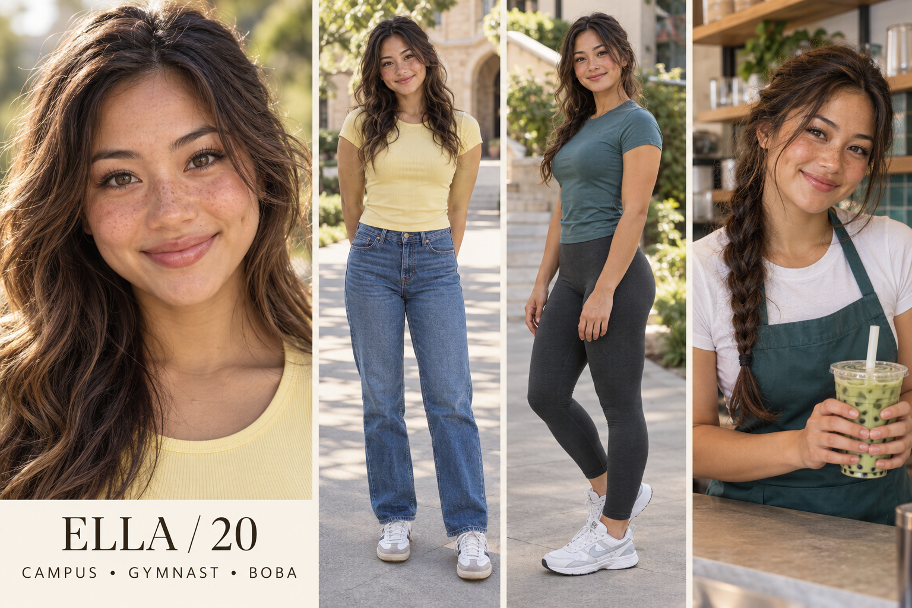

# Ella — Sunny outdoorsy gymnast

Fictional adult woman, age 20. 5 ft 2 in (157 cm), nominal design target. College student and part-time boba barista. Recreational gymnastics; exploring Pilates. Major: Environmental studies.

## Appearance and continuity
Filipina and English heritage, medium golden skin, softly square face, warm brown eyes, long wavy dark brown hair with subtle sun-lightened ends, natural freckles on cheeks, wide joyful smile and one dimple. This is an individual fictional design, not a heritage-based beauty formula.

Campus: butter-yellow fitted tee, blue straight jeans, retro sneakers.
Gym/Pilates: teal athletic tee and charcoal full-length leggings.
Tea counter: white tee and teal apron, hair in practical braid.
Beauty: Peachy cheek color, warm lip tint and natural wavy hair; avoid manufactured product-result claims.

Lock the selected face, complexion, haircut and body proportions to this reference; small marks need a dedicated reference close-up before production. Heritage and exact height cannot be verified visually from the sheet.

## Personality and performance
Sunny, energetic and a little spontaneous; turns a short errand into a long walk.

Voice: Open, animated delivery with natural laughs and quick changes in emphasis.

Appeal hypothesis: Warmth, expressive reactions and outdoor motion create energy; easy beauty and drink rituals connect that energy to products.

## Brand positioning
Matcha, casual activewear, water bottles, tinted lip products and hair accessories.

Recurring series:
- Matcha and the long way home
- Campus bag outside edition
- Post-class five-minute reset

Draft fictional hooks:
- “The walk was supposed to take ten minutes.”
- “My matcha is coming on this side quest.”
- “One hair clip versus this entire forecast.”

## Direction to watch
Keep sustainability and SPF claims tied to actual product evidence; sunny styling is not proof of efficacy.

Use disclosed fictional storytelling and accurate product demonstrations. No invented testimonial, real school affiliation or actual partnership is implied. All audience advantages remain untested.

